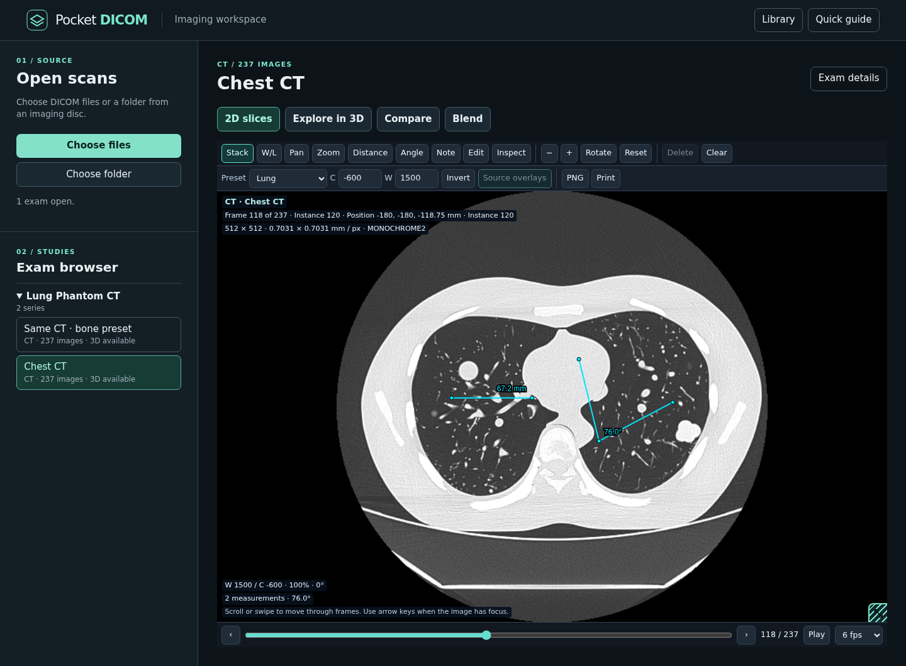
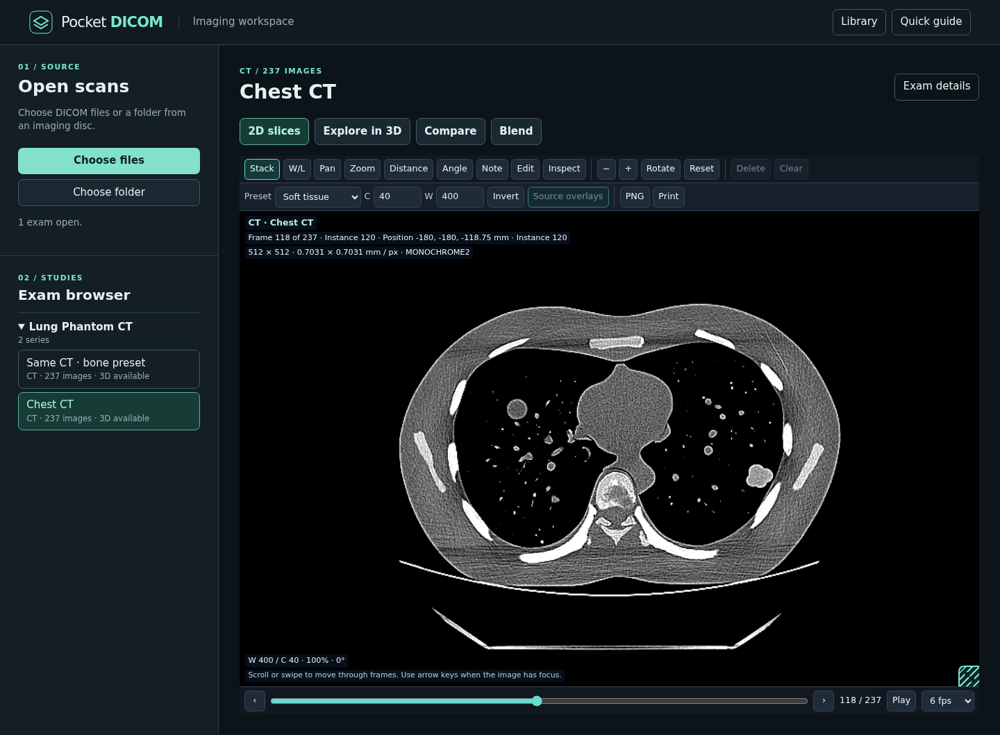
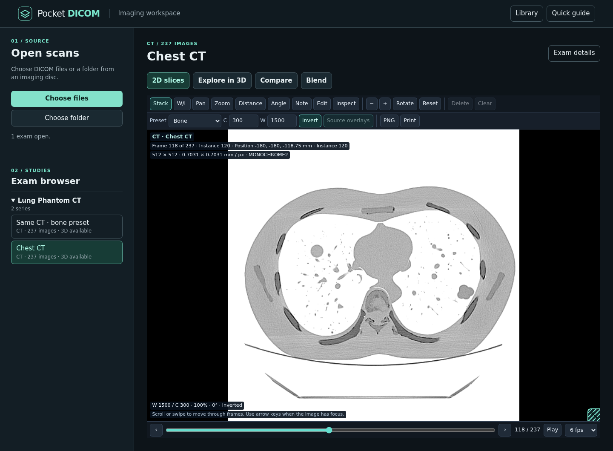
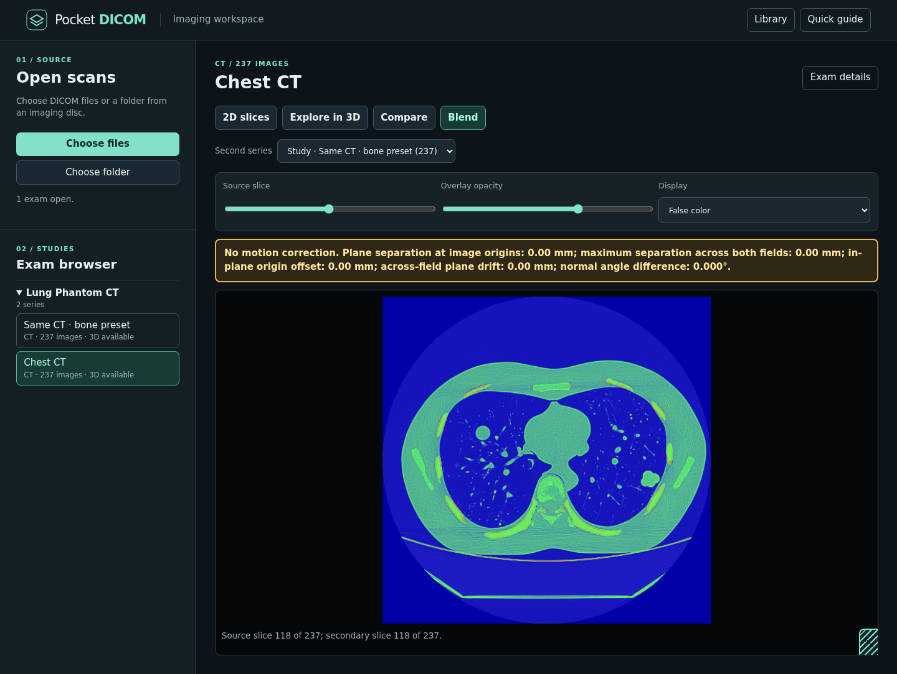
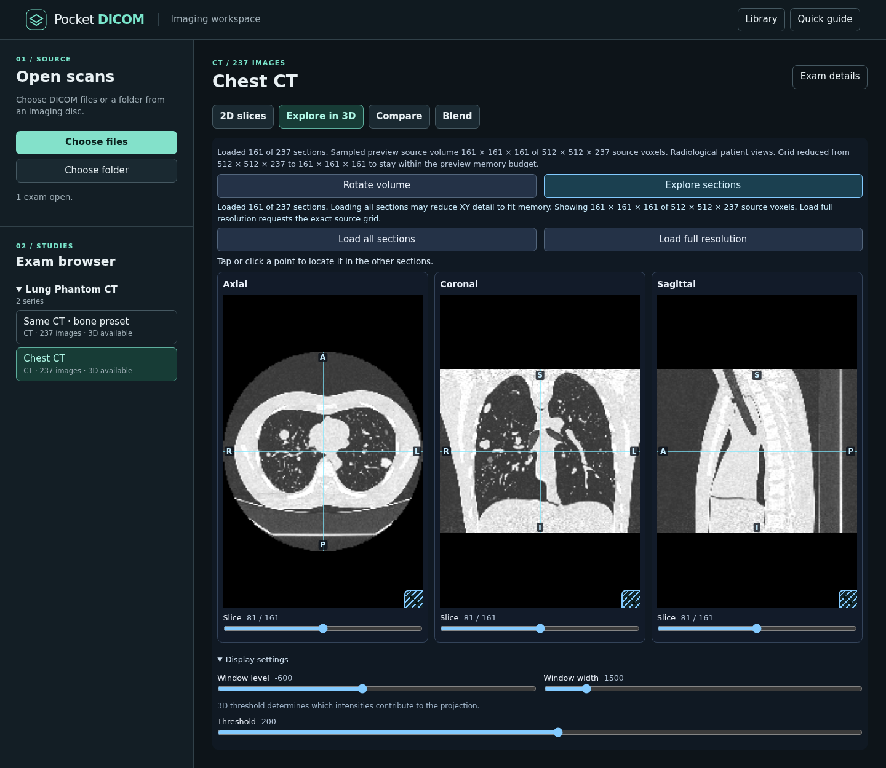

# Pocket DICOM

A small self-hosted imaging workspace for desktop and mobile browsers. The interface uses browser modules, Canvas, and local styles. No Node build, account, CDN, or remote image service is needed. A Python server on your computer reads the DICOM files and sends decoded frames to your browser.

## Screenshots

A chest CT of an FDA anthropomorphic lung phantom, with 237 slices and artificial nodules. The measurements are examples drawn on the phantom.



| Soft-tissue preset | Bone preset with grayscale inversion |
| --- | --- |
| [](docs/chest-ct-soft-tissue.png) | [](docs/chest-ct-bone-inverted.png) |

| False-color blend | Multiplanar sections |
| --- | --- |
| [](docs/chest-ct-false-color.png) | [](docs/chest-ct-mpr.png) |

[3D maximum-intensity projection with an adjustable threshold](docs/chest-ct-3d.png) · [Mobile slice viewer](docs/chest-ct-mobile.png)

Image source: B. Zhao, *Lung Phantom* (version 2), The Cancer Imaging Archive, [CC BY 3.0](https://creativecommons.org/licenses/by/3.0/). The screenshots show the original phantom pixels with viewer windowing, color mapping, or annotations applied. The Blend example overlays two display presets of the same acquisition. [Dataset](https://doi.org/10.7937/k9/tcia.2015.08a1ixoo) · [TCIA citation](https://doi.org/10.1007/s10278-013-9622-7)

## Run with Docker

The container image is available on GitHub Container Registry for Linux AMD64 and ARM64.

```sh
docker run --pull always -d --name pocketdicom \
  -p 127.0.0.1:8765:8765 ghcr.io/fabiocamin8/pocketdicom:latest
docker logs pocketdicom
```

Append the pairing path printed in the logs to **http://127.0.0.1:8765**. Keep that path private.
The example binds the host port to loopback. To use the viewer from a trusted LAN, bind to the host's LAN IP and keep external port 8765.

To open a local DICOM library, add `--mount type=bind,source=/path/to/dicom,target=/dicom,readonly` before the image name and `--library /dicom` after it. Make sure container UID/GID 10001 can read the directory. The image contains no DICOM studies.

Each published GitHub release builds an image under its release tag (for example, `v1.0.0`). Stable releases also update `latest`. Use a version tag to pin a release. To update a running installation, pull the new image and recreate the container with the same options. Recreating always clears temporary workspaces and changes the pairing link; only content saved in the library store persists.

## Persistent library

The Docker examples above keep imports in the container, so recreating it discards them. For a library that survives container restarts and re-creation, create a separate writable directory on the host, mount it at `/library`, and pass `--library-store /library`. Optionally mount a seed folder read-only at `/dicom` and pass `--library /dicom`; the seed is an initial source and is never written to.

```sh
mkdir -p /path/to/dicom-library
sudo chown 10001:10001 /path/to/dicom-library

docker run --pull always -d --name pocketdicom \
  --mount type=bind,source=/path/to/dicom-seed,target=/dicom,readonly \
  --mount type=bind,source=/path/to/dicom-library,target=/library \
  -p 127.0.0.1:8765:8765 \
  ghcr.io/fabiocamin8/pocketdicom:latest \
  --library /dicom --library-store /library
docker logs pocketdicom
```

Options after the image name belong to the viewer. Omit the seed mount and `--library /dicom` to start with an empty library. Container UID/GID 10001 needs read access to the seed folder and read/write access to `/library`; the `chown` above assumes a dedicated host directory. Seed files are mounted at runtime only and are not copied into the image or the build context.

Open the pairing path printed in the logs. **Library** lists studies from the read-only seed and saved uploads together. Use **Add files** or **Add folder** to import into the store. Stored imports remain on the host across container restart and re-creation, including image updates, and are available to other paired viewers of the same server. Re-creation changes the pairing link, so read the new path from `docker logs`. **Choose files** and **Choose folder** remain temporary and do not write to the store. After selecting an exam, **Exam details** shows its source metadata.

To open the viewer directly on a trusted LAN, add `--no-pairing` to the viewer arguments and open the server URL. All devices that can reach that address can view the shared library and, with `--library-store` configured, add files to it. The instance serves unencrypted HTTP and is not a certified diagnostic workstation.

## Start the viewer without Docker

```sh
cd pocketdicom
./start.sh --host 127.0.0.1 --port 8765 --library "/path/to/dicom/IMAGE"
```

Open **http://127.0.0.1:8765** and choose **Library**. Leave the terminal running. Stop it with `Ctrl-C`. To use another collection, change `--library` or omit it and use **Choose files** or **Choose folder**. Select the actual DICOM images, including files with no extension; `DICOMDIR` by itself is only a catalog. An import opens a new workspace.

For a persistent library, `--library-store` must point to an existing writable directory:

```sh
./start.sh --host 127.0.0.1 --port 8765 --library-store "/path/to/dicom-library"
```

The launcher creates an isolated Python environment and installs the dependencies on first use; `uv` or a Python installation with `venv` and `pip` is required. Later launches reuse the environment. The viewer itself does not need internet access.

## Use a phone or tablet

Start a second server on a trusted local network:

```sh
cd pocketdicom
./start.sh --host 0.0.0.0 --port 8766 --library "/path/to/dicom/IMAGE"
```

Open the **pairing link** on the phone using the server's LAN IP and port `8766`. Both devices must be on the same network. After pairing, tap **Library**. The images stay on your server and the viewing device. This LAN mode uses HTTP; use a trusted network. The default desktop server listens only on this computer.

## Use the viewer

- **Exam browser:** Select a study and series. On a narrow screen, **Show exam browser** brings back the list. **Exam details** shows the source metadata.
- **2D slices:** Scroll a series or play it as a sequence. Adjust contrast, magnify or move the image, inspect a CT pixel, measure a length or angle, or place a text note. Original DICOM overlays are distinct from notes you draw. PNG export and Print include visible overlays and completed annotations. Pixel distances are not millimetres when a file has no physical scale.
- **3D:** Compatible series open in **2D slices**. Choose **Explore in 3D** to see a maximum-intensity projection (MIP). Drag or use the arrow keys to rotate. Pinch, use the wheel or **Zoom** slider, or press **+** and **−** to zoom. **Reset view** or **Home** restores the initial rotation and zoom. Open **Display settings** to adjust window level, window width, and the threshold for intensities included in the projection. The projection starts in preview. The hint reports the displayed pixel dimensions and the source voxel grid. In **Explore sections**, tap or click a point to locate it in the other sections. Screens up to 650 px show one section at a time with a plane selector. Wider screens show all three. Switching between **Rotate volume** and **Explore sections** keeps the selected point, camera, and display settings for the open series. Choose **2D slices** to return to the original frames at their original resolution. Sampled previews can omit small structures. For a 2D-only series, the reason appears beside the disabled **Explore in 3D** action.
- **Compare:** Choose a second series. If both series use compatible patient coordinates, **Link slice positions** follows the nearest corresponding slice. Otherwise the panels scroll independently.
- **Blend:** Superimpose compatible CT series with adjustable opacity. Use side-by-side views when patient motion makes the overlap unreliable. The viewer does not estimate motion or register unrelated exams.

Measurements and notes survive switching views and series within the same browser workspace. Reloading the page or importing another collection clears them; export a PNG or print to retain a copy. Nothing is written to the source DICOMs. This is a viewing tool, not a certified diagnostic workstation.

**Resize an image panel.** Drag its bottom-right grip to change the width and height. On a touchscreen, drag the same grip with one finger. With a keyboard, focus the grip and use the arrow keys. Each comparison and section panel has its own grip.

**3D resolution.** Every device opens a quick volume, sampled when necessary. Small series can already fit at their original resolution. **Load full resolution** loads the original voxel grid within the 256 MiB limit for full-detail sections, and later full-size views reuse that completed volume without reading the sections again. **Load all sections** keeps every section within a 16 MiB grid and can reduce in-plane detail. **Full-size current view** uses original voxels and display pixels for the current pose. The next change to camera, window, or threshold returns to the interactive preview. **Full-size 3D** keeps full detail while rotating or zooming. **Restore preview** cancels a pending upgrade and immediately reuses the original quick volume at the current pose without reading the sections again.

**Legacy DICOM titles.** The catalog uses the character set declared by the DICOM file. For a known legacy source that declares ASCII or omits the character set while using non-ASCII bytes, set the container environment variable `POCKET_DICOM_LEGACY_CHARSET` to its actual encoding (for example `euc_kr`, `gb18030` or `cp1251`). This affects display only. Files with a valid non-ASCII charset declaration retain their own decoding.

## Checks

```sh
node --test tests/*.mjs tests/*.js
.venv/bin/python -m pytest -q tests
```

The Python test suite uses `pytest` and the FastAPI test-client dependencies (`httpx`, `httpx2`). For browser acceptance tests, install the optional `playwright` Python package in the same environment and have Chrome installed. Run `tests/smoke_browser.py http://127.0.0.1:8765` with that Python. It generates synthetic scans, exercises desktop and touch layouts, checks the guided 3D MIP and section views, and verifies that a one-frame 2D-only series explains why 3D is unavailable. Chrome is used by default; if Chrome is not installed, set `PW_EXECUTABLE_PATH=/usr/bin/chromium` (or another executable path) to launch an installed Chromium build. Set `PW_BROWSER=webkit` after `python -m playwright install webkit` to repeat the checks with WebKit. `tests/smoke_exam_library.py` generates a synthetic seed and exercises the persistent library. See the commands at the top of that script.

## License

Pocket DICOM is licensed under [GNU GPL v3.0 only](LICENSE) (`GPL-3.0-only`). Third-party components retain their own licenses.
